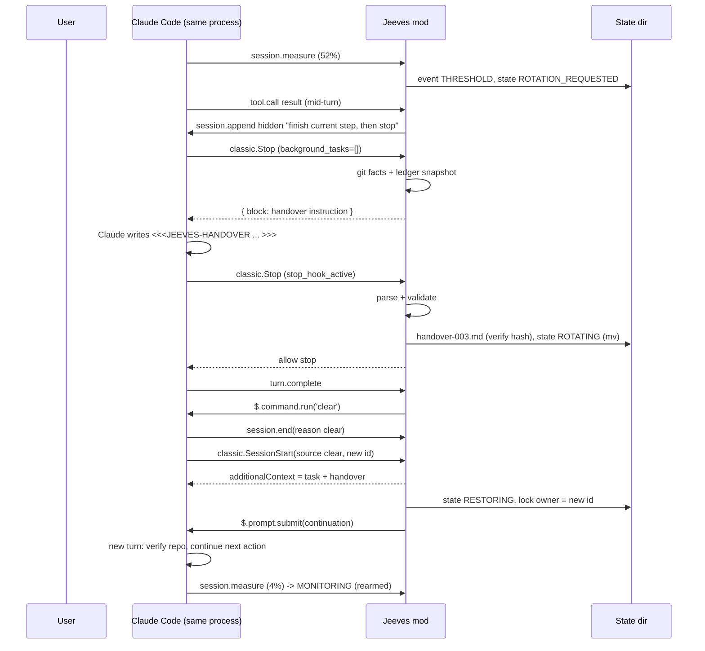

# 02 — Architecture and ADRs

## 1. Options evaluated

| Criterion | A. Mod-only | B. Mod + supervisor | C. Assisted mode |
|---|---|---|---|
| Fresh conversation | `/clear` via `$.command.run` [V-LIVE] | Kill + respawn `claude "<prompt>"` | User runs `/clear` |
| Continues without user input | `$.prompt.submit` [V-LIVE] | Initial prompt arg [V-DOCS, auto-submit not stated] | **No** (fails FR-09) |
| Terminal fidelity (NFR-02) | Untouched: same process | Risky: PTY or stdio hand-off, signals, raw mode restore | Untouched |
| Permissions/auth/MCP/model (FR-08, FR-17) | Kept [V-LIVE] | Must re-pass every flag; session-granted rules lost | Kept |
| Install | One plugin line | Plugin + npm/brew CLI + user must launch via wrapper | One plugin line |
| Moving parts | 1 hooks module | 2 processes, IPC, process supervision | 1 hooks module |
| Failure modes | Mod API change | API change + PTY/signal/zombie issues | Few |
| PRD rule | Preferred | Only if A fails | Only if A and B fail |

**Decision: A.** B adds a second distribution and the PRD's highest-risk area (R-02) to solve a problem A already solves. C is kept only as a runtime degradation (ADR-002).

## 2. ADRs

Format: Context → Decision → Consequences → Alternatives rejected. All ADRs are *Proposed* until maintainer sign-off at the M0 gate. **Status: ADR-001…010 Accepted by the maintainer on 2026-11-07, including ADR-004 A1 and ADR-010 A1 (D-15). Turn-mode amendments (ADR-002 A3, ADR-003 A2, ADR-004 A2, ADR-006 A1, ADR-007 A1, revision 2) accepted on 2026-11-09 (D-48).**

### ADR-001 — Mod-only architecture
- **Context:** SPIKE-01/03/05 passed on 2.1.319 (see 01 §3).
- **Decision:** Ship a single Claude Code plugin with one hooks module. No supervisor, no launcher, no PTY.
- **Consequences:** Simplest install and zero terminal risk; full dependence on the early-access mods API (mitigated by ADR-002 and the compatibility suite). Repo has no `supervisor/` package.
- **Rejected:** B (cost without benefit), Agent SDK (not the interactive TUI [V-DOCS]), keystroke injection/transcript editing (PRD §9.4 forbids).

### ADR-002 — Capability probe and honest assisted mode
- **Context:** API is early access; org policy can disable mods/hooks; older builds may lack primitives.
- **Decision:** At `session.start`, probe: engine version in supported range; presence of `$.command.run`, `$.prompt.submit`, `$.session.usage`, `$.process.run`; `classic.Stop` hook registered. Result = `full` | `assisted` | `unsupported`. If `$.command.run('clear')` rejects at rotation time, switch the task to `assisted` permanently for that process: the validated handover is kept and the user is told "Run /clear, then type /relay continue" (one command, still no copy-paste). Status and README always show the active mode. Never claim AC-10/11 in assisted mode (AC-25).
- **Consequences:** Users on unsupported versions get a precise message and no rotation (FR-01).
- **Rejected:** Silent fallback (PRD forbids hidden degradation).
- **Amendment A1 (2026-11-07, ST-1.8):** No `typeof` presence checks: Claude Code 2.1.319's module scanner refuses a `$` noun used as a value (`$.command is used as a value`), and there is no capability API. The probe is: version gate; one harmless call each to `$.session.usage()` and `$.process.run(['true'])`; `$.command.run` and `$.prompt.submit` are checked at first use, where a rejection switches the task to `assisted` (as above for `/clear`). Logged as D-16 in 07 §2.
- **Amendment A2 (2026-11-08, R-25, D-39):** the "`classic.Stop` hook registered" fact is gone (nothing could observe it). Instead, a main turn that ends with an answer, not interrupted, without Jeeves's `classic.Stop` running marks the Stop hook as skipped for the process: mode `unsupported` (not assisted: without Stop there is no boundary and no handover), measuring and prompt holding stop, and `on`/`resume`/`rotate`/`retry` are refused. A version refusal keeps its own message.
- **Amendment A3 (2026-11-09) (turn mode, `docs/specs/team-accounts-turn-mode.md`, D-48; **revision 2, accepted by the maintainer on 2026-11-09**):** when A2's check sees the Stop hook skipped, the process switches to **turn mode** instead of `unsupported`: mode stays `full`, status shows `mode: full (turn)`, measuring and prompt holding go on, and every command works. **The trigger is the skip itself, for any cause**, not the account type; the one cause seen so far is Claude Code's built-in `cc-plugin-sec-default` on Team organizations (debug log `seated outermost: the organization is team`), a built-in default, not a setting an admin chose. Whether it is meant to block plugins could not be confirmed (no contact channel, D-48). Turn mode does not get around it: it uses only events and calls the built-in passes on, and an organization that turns mods or hooks off by policy still turns Jeeves off. Turn mode is chosen only after the skip is seen; a process where Stop arrives never runs it. If the skip is seen while a rotation is already requested, the turn-mode boundary (ADR-004 A2) takes it over at the same `turn.complete`. **Changes A1 for this mode:** a `$.prompt.submit` that fails in turn mode makes the process `unsupported`, not `assisted` (with neither Stop nor submit there is no way to ask for a handover); a version refusal stays `unsupported` with its own message. **Note (2026-11-09, maintainer, ST-15.4 review finding 4):** after a refused submit makes the process `unsupported`, this session's task does not wait on it: an auto task ends (DISABLED, lock released), an explicit task keeps its state and gives up its lock, so `/jeeves recover` in another session can continue it.

### ADR-003 — Handover format: verified facts + sentinel-delimited Markdown narrative
- **Context:** FR-06/07 need structure, deterministic facts and readable Markdown (NFR-09). Plugin-registered tools have no permission field, so a handover tool might prompt for permission and needs ToolSearch.
- **Decision:** The handover file has two parts:
  1. **Verified section**, generated by the plugin: task/session IDs, cwd, repo root, worktree, branch, HEAD, `git status --porcelain`, files changed since task start, edit ledger, command ledger (command, exit status, time), scheduled session crons (from Stop `session_crons`; ADR-004 A1) — from `$.process.run(git)`, `tool.call` hooks and Stop input only.
  2. **Narrative section**, written by Claude in its final message between `<<<JEEVES-HANDOVER v1` and `JEEVES-HANDOVER>>>`, with required headings (§6.4). Each bullet tagged `[verified]`, `[inferred]` or `[unknown]`.
  The plugin reads the block from the Stop event's `last_assistant_message`, parses, validates (ADR-004 rules), then writes the merged file.
- **Consequences:** No tool registration, no extra permission, no ToolSearch. The handover is visible in the old transcript (transparency). Parsing needs a robust tolerant parser + bounded retries (Stop cap of 8 leaves room for 2 retries).
- **Rejected:** Registered tool with JSON schema (permission/ToolSearch unknowns; kept as fallback if S-05 parse rate < 90%); model writes a file with Write (permission prompt outside project, git contamination inside it).
- **Channel recorded (M0, S-05):** the merged handover is delivered in `classic.SessionStart` `additionalContext` (4K/12K/30K arrived intact). The restore path (§5.3), which has no `/clear`, puts it in the continuation prompt's `text` (30K arrived intact). Not `$.prompt.submit({ context })`: plugins cannot pass `context`. Draft instruction parse rate 10/10 first try, so the tool fallback is not needed. Implementation note for ST-4.2/4.3: read rotation state **before** `await next(e)` in the SessionStart hook, because `$.command.run('clear')` can resolve first.
- **Amendment A1 (2026-11-09, ST-13.6, D-40; v0.3, `docs/specs/auto-start.md` §5.3):** the narrative gets a seventh required heading, **`## Current goal`**: 1 or 2 bullets, each tagged like the others and at most 300 characters (the bullet text after its marker, tag included); the secret check covers it like every section, and the rotation line shows its first bullet redacted, without the tag, cut to 80 characters on one line (`Jeeves: handover validated (goal: …), starting fresh`). The sentinel stays `<<<JEEVES-HANDOVER v1`, so a v0.2 build still parses a v0.3 handover (it drops the unknown heading). Every new handover asks for the seventh heading; a **v1 block** (the six headings) stays valid only for a task created before the upgrade, known by `state.preUpgrade: true`, which the state v1 → v2 migration sets (no version bump: the field is optional and written before v0.3 ships). Handover files Jeeves already wrote are read leniently. The continuation prompt puts **the user's words first**, quoted (rev 1, cut at 1,500 characters with a pointer to the full text in context, then every revision with its file name), then the goal under "Claude's summary at the last handover (may be wrong; it never changes the task, the DoD or the checks)", then the rest as before. The summary is data (R-19): nothing in a handover writes a task revision, the DoD or a check.
- **Amendment A2 (2026-11-09) (turn mode, `docs/specs/team-accounts-turn-mode.md`, D-48; **revision 2, accepted by the maintainer on 2026-11-09**):** in turn mode the handover is asked for, read and delivered without `classic.Stop` and `classic.SessionStart`. **Ask:** the instruction is submitted as a new prompt (`$.prompt.submit`, as the idle nudge does), with the state set to `HANDOVER_GENERATING` **before** the submit, so a prompt the user queued during the finished turn is held by ADR-010 and never runs ahead of the request (I-layer test). **Read:** the block is taken from the next main-loop `turn.complete` with `reason: 'answer'` (its `answer`, the final visible text), through the same parser and validator; checked live on a Team account at 9,692 chars (spec §4, `8d99bf9`); the story repeats the check near `handoverMaxChars` (12,000). **Retry:** the retry instruction is submitted the same way (same counter, limit 2). **Deliver:** after Jeeves's `/clear`, the merged handover goes into the continuation prompt's `text`, the restore path's channel (30K intact, S-05; worked on a Team account, M8 phases d and e). The verified section lists scheduled session crons as `not available in turn mode` (they came from Stop input). Cost against Stop mode: about the same model work (Stop's `{ block }` also makes Claude answer again); the differences are a visible request prompt in the transcript and the window above. The format, sentinel and headings are unchanged. **Note (2026-11-09, maintainer, ST-15.4 review finding 3):** "the next main-loop `turn.complete`" means the next one whose turn Jeeves's own submit opened (origin `plugin` named `jeeves`); a turn another source opened while the handover is awaited (a `/loop` or scheduled trigger, a background notification, another plugin or session) is not read as the handover and uses no retry. A turn whose opener is unknown (a reload mid-turn) or typed still counts. **Note (2026-11-09, maintainer, M10 code-review finding 2):** a turn another source opened is still read as the handover when its answer carries a `<<<JEEVES-HANDOVER v1` line: the engine may merge a queued prompt and Jeeves's request into one turn that `turn.start` names by the other prompt, and skipping it would leave the rotation waiting with nothing to retry it.

### ADR-004 — Safe boundary = main-loop Stop with nothing in flight
- **Decision:** Rotation work (handover request, validation, `/clear`) only starts inside `classic.Stop` for the main loop when all hold: turn not aborted; `background_tasks` empty; no `$.agent.list()` entry with status `running`; state is `ROTATION_REQUESTED`. Session crons do **not** block (amended after S-04, see below); they are listed in the handover's verified section. Otherwise stay `QUIESCING` and re-check at the next Stop. After `quiesceMaxTurns` (default 3) Stops or `quiesceMaxMinutes` (default 20) without a safe boundary → `PAUSED(UNSAFE_BOUNDARY)` with a status message. Mid-turn, once the threshold is crossed, append one hidden "finish the current step, do not start new work, then stop" row (soft quiesce, S-03).
- **Consequences:** Never interrupts a tool, an edit, a permission prompt or a subagent (AC-07). The rotation may happen a few percentage points past the threshold; that is expected and logged.
- **Rejected:** `turn.abort` (interrupts work), polling timers (no safety signal).
- **Evidence (M0):** S-02 confirmed the gate live: `background_tasks` lists running `shell`/`subagent` items, and each finished job starts a new turn by itself, so the next Stop re-checks without polling. S-03 confirmed the soft-quiesce note (5/5, 0 further tool calls).
- **Amendment A1 (2026-11-07, after S-04):** `session_crons` removed from the unsafe-boundary conditions. Reason: crons survive a plugin-invoked `/clear` (they belong to the process, not the conversation), so rotating cannot break them. A cron that fires mid-rotation is not origin `composer`, so ADR-010 does not hold it; it queues and runs after the continuation, with the handover already injected. Logged as D-11 in 07 §2.
- **Amendment A2 (2026-11-09) (turn mode, `docs/specs/team-accounts-turn-mode.md`, D-48; **revision 2, accepted by the maintainer on 2026-11-09**):** in turn mode the safe boundary is a main-loop `turn.complete` with `reason: 'answer'`, not aborted, no `$.agent.list()` entry `running`, Jeeves's own background count at zero, and state `ROTATION_REQUESTED`. The count replaces Stop's `background_tasks`, which no event outside `classic.*` carries (2.1.319 types). **Rules:** counting starts at `session.start` in every process (before turn mode is chosen, so work from the turn that reveals the skip is counted); it goes up at a `tool.call` that started work in the background and down at a `prompt.submit` with `origin.kind: 'task-notification'`, clamped at zero (a notification for work started before counting cannot make it negative); it resets to zero at each Jeeves `/clear` and whenever the task leaves `PAUSED(UNSAFE_BOUNDARY)`, so one lost notification costs at most one pause, not every later rotation. A count that never drops is bounded by the existing rule: after `quiesceMaxTurns` (3) turns or `quiesceMaxMinutes` (20), whichever comes first, the task goes to `PAUSED(UNSAFE_BOUNDARY)` with its message. Open, for the story: whether a background shell the user kills produces a `task-notification` (if not, the reset above covers it). Soft quiesce is unchanged (`tool.call` arrives). AC-07 holds: `turn.complete` comes after the turn ended, so no tool, edit, permission prompt or subagent is in progress.

### ADR-005 — Local storage, atomicity and locking
- **Context:** `$.fs` has no rename/fsync/append; concurrent hooks can race (observed).
- **Decision:**
  - **State root:** a documented per-plugin data dir if S-06/Q5 finds one; else `~/Library/Application Support/Jeeves/` (macOS), `${XDG_STATE_HOME:-~/.local/state}/jeeves/` (Linux). Override with `userConfig.stateDir`. Never inside the repo by default.
  - **Single writer per process:** every write goes through one serial queue in the adapter.
  - **Immutable files:** `history/handover-NNN.md`, `sessions/NNN.json`, `task-rev-NNN.md` are write-once; after writing, read back and compare SHA-256 (via `crypto.subtle`).
  - **Mutable pointer:** `state.json` is written as `state.json.tmp-<rand>`, read back and hash-checked, then `$.process.run(['mv', '-f', tmp, 'state.json'])` (POSIX rename is atomic on one filesystem). fsync is unavailable: documented residual risk (power loss could lose the last transition; recovery re-derives from `events.jsonl` + immutable files).
  - **Lock:** `$.process.run(['mkdir', '<task>/lock.d'])` (atomic create) + `lock.d/owner.json` `{ ownerSessionId, acquiredAt, heartbeatAt }`, heartbeat every 30 s via `$.clock.every`. Stale after 120 s without heartbeat → recoverable only through `/relay recover` (or auto-recover if opted in), which takes over after re-checking staleness.
  - **Event log:** `events.jsonl` appended via the serial queue (read + write); rotated to `events-NNN.jsonl` at 1 MiB (the read limit is 4 MiB).
  - Files created with user-only permissions where the host allows (`chmod 700` dir via `$.process.run` once at init).
- **Rejected:** `$.store` as the only store (4 MiB cap, opaque location, not human-readable handovers); project-local `.jeeves/` default (git contamination risk).
- **Evidence (M0, S-06):** `mkdir` lock (exit 0, then exit 1 on a second call) and `mv -f` swap both ran via `$.process.run` with no permission prompt. A `--plugin-dir` mod gets no per-plugin data dir (`CLAUDE_PLUGIN_DATA` unset), so the OS-standard state root stands. Re-check an installed mod in M6 (Q-3). Confirmed, not amended.

### ADR-006 — Compaction policy
- **Decision:** While a managed task is `MONITORING`…`CONTINUING`: return `{ skip }` for `precompute` triggers only. Let `auto`/threshold compaction run (blocking it at the limit would overflow). After any compaction in a managed task: log `COMPACTED`, force `ROTATION_REQUESTED` (compacted context is lossy; a curated handover is better). Manual `/compact` by the user is allowed and logged.
- **Rejected:** Blocking all compaction (overflow errors).
- **Amendment A1 (2026-11-09) (turn mode, `docs/specs/team-accounts-turn-mode.md`, D-48; **revision 2, accepted by the maintainer on 2026-11-09**):** in turn mode `session.compact` does not arrive, so precompute compaction can no longer be skipped. A compaction is recognised from `session.measure`: a reading whose context tokens fall sharply with no Jeeves `/clear` and no user `/clear` since the last reading. The story sets the size of the fall and tests it against a **rewind** too (a rewind also drops tokens; read as a compaction, it causes one rotation that was not needed: harmless, noted). A recognised compaction is handled as today: `COMPACTED` logged, the completion rules re-appended (ADR-007 A1), `ROTATION_REQUESTED` at the next safe boundary.

### ADR-007 — Completion requires machine evidence
- **Decision:** A task has optional DoD criteria (text) and optional verification commands (user-authored, stored in `task.md`). Claude signals completion with a `<<<JEEVES-COMPLETE v1 … >>>` block. The plugin marks `COMPLETED` only if every verification command appears in the command ledger with exit 0 **after the last edit**, and the block lists no open blockers. Missing evidence → block Stop once with the list of missing checks so Claude can run them through its own Bash tool (normal permissions). Still missing → `NEEDS_REVIEW`. With no verification commands, completion always goes to `NEEDS_REVIEW` and the user confirms with `/relay done`.
- **Consequences:** The plugin never executes a shell string from the task or handover (FR-16); "done" text alone never completes (AC-13).
- **Amendment A1 (2026-11-09) (turn mode, `docs/specs/team-accounts-turn-mode.md`, D-48; **revision 2, accepted by the maintainer on 2026-11-09**):** in turn mode `prompt.compose` does not arrive, so the completion rules go in as a **hidden row** with `$.session.append` (the channel already used for the soft-quiesce note and the §5.3 recovery path), not as prompt context: the engine does not re-run Jeeves's hooks on its own `$.prompt.submit` (§7), and plugins cannot pass `context` (ADR-003, S-05). The row is appended when a task starts (after its first prompt is captured or submitted), after every continuation, after a recognised compaction (ADR-006 A1), and again every 10 turns, so a compaction Jeeves did not recognise loses them for at most 10 turns. The completion block is read from `turn.complete`'s `answer`. "Block Stop once with the missing checks" becomes one submitted prompt listing them; still missing after that turn goes to `NEEDS_REVIEW` as today.
- **Known limit of A1 (2026-11-09, maintainer, after ST-16.8; accepted, no change):** live on 2.1.319 the engine drops rows appended mid-turn again before the turn's last request, where a completion claim is written, and the first turn of a `claude` process gets no row (turn mode is known only at its end). The row goes in at a turn's first main tool result. A claim written without the rules is still checked by the ledger rule above, so a wrong claim never completes a task; at worst a claim is missed or malformed and the task is claimed at a later turn. Not changed: putting the rules in the continuation prompt too would need a new amendment. Evidence: `docs/done/evidence/v0.3.0/turn-mode/RESULT.md`.
- **Amendment A2 (2026-11-09, maintainer, M10 run-2 stall):** an unattended task must not wait for a person because Claude ended a turn by announcing its next step. In the conversation an automatic rotation opened for an **auto** task (after the continuation prompt went out), the first Stop (turn mode: answered `turn.complete`) in MONITORING or CONTINUING with no completion block and no background work gets **one** carry-on prompt (`CARRY_ON_PROMPT`): take the named next step, or end with the completion block, or say what the user must do and stop. Never a second in that conversation, none once the user has typed in it, none for explicit tasks; a reload forgets it (no carry-on). Completion still needs the ledger evidence above.

### ADR-008 — Pure core, thin adapter, zero runtime dependencies
- **Decision:** `src/core/**` is pure TypeScript with no `$`, no I/O, no clock (time passed in). `hooks/register.ts` + `src/adapter/**` translate engine events into core inputs and execute core outputs (effects). Runtime schema validation is hand-written (small, typed guards). Dev dependencies: `typescript` only; unit tests run on Node's built-in `node:test` with type stripping (Node ≥ 22.6); mod integration tests run under `claude plugin test`.
- **Rejected:** zod/xstate/etc. (mod runtime has no npm resolution guarantee; bundling adds a build step and supply-chain surface).
- **Clarified (M0, S-05):** `claude plugin validate` does not type-check. `npm run typecheck` must run `tsc --strict` on `hooks/` and `src/` against the engine-written `claude-code` types: S-05 hit a silently ignored argument that only `tsc` caught.

### ADR-009 — Opt-in managed task and command surface
- **Amendment A1 (2026-11-08, maintainer, D-29):** the command is **`/jeeves`**, matching the product name; `/relay` is now the fallback when `/jeeves` is taken. Every `/relay <sub>` in these plans reads as `/jeeves <sub>`.
- **Amendment A2 (2026-11-08, maintainer, D-31, D-30; M8):** two new user-typed subcommands. `/jeeves retry` leaves NEEDS_REVIEW(HANDOVER_INVALID) for a new rotation and NEEDS_REVIEW(POSSIBLE_LOOP) for MONITORING (rows in §4); it never runs by itself, so "no auto-rotation from NEEDS_REVIEW" still holds. `/jeeves defaults` keeps per-project defaults (threshold, verification commands) in `projects/<projectId>/config.json` in the state folder (§6.1), copied into a task at `/jeeves on`; a task's own settings win.
- **Amendment A3 (2026-11-08, maintainer, D-40 … D-43; v0.3, `docs/specs/auto-start.md`):** on a **fresh install, installing is the opt-in**. A session is auto-watched when, at `session.start`, it is interactive, in full mode, inside a git work tree, on a context window above 200K tokens, a fresh conversation (`$.session.turns()` 0), and auto-start resolves to on; this is decided once per session. Its first prompt typed at the terminal (origin `composer`, not a slash command) creates an **auto** task, saved word for word as revision 1; no other origin kind starts one, and nothing is recorded before that prompt. The first-run notice comes at `session.start`, before any recording (plugin-store key `autoNoticeShown`). Auto-start is off per session (`/jeeves off`), per project (`/jeeves defaults auto off`), everywhere (`/jeeves auto off`, which writes `auto.json` in the state folder, never Claude settings) or through the `/config` row `autoStart` (`default`, `on`, `off`); precedence: session, project, the row when `on`/`off`, `auto.json`, then the default. **Upgraders keep the v0.2 promise:** the upgrade check runs **once per install**, at the first v0.3 `session.start`: the install is an upgrader when the plugin store has `firstActivationShown` (written only by v0.2) or the state folder holds a project, and fresh otherwise. An upgrader gets `auto.json` with `default: off`, and nothing is auto-watched until `/jeeves auto on` or the row. The result is kept in the plugin store as `upgradeCheck` (`upgrader` or `fresh`), written in the same step; later sessions skip the check, and a state folder without `auto.json` (a new `stateDir`) takes its default from `upgradeCheck`. v0.3 never writes `firstActivationShown`. `/jeeves on [goal]` always makes an **explicit** task as before. A task records `origin: auto | explicit` (v0.2 tasks read as explicit). AC-03 now reads: no rotation unless the user typed `/jeeves on` or the session was auto-watched under these rules; nothing recorded before the first typed prompt; never auto-watched for an upgrader who has not turned it on. New user-typed subcommands: `later`, `auto on|off`, `defaults auto on|off`, `handover`. Auto tasks differ from explicit ones only where the spec says so: a user `/clear` ends them (ADR-010 unchanged for explicit tasks), they recover by themselves under the same gates (D-43), and ended ones without a rotation are deleted after 7 days. The matching ADR-003 (seventh heading, Current goal) and ADR-010 amendments are written with ST-13.6 and ST-13.7.
- **Amendment A4 (2026-11-09, maintainer, D-53; v0.3.x, plan 10 P-1, P-2):** a window of **200K tokens or more** is eligible for auto-start (A3 said "above 200K"); D-45's bar was met (D-52). The reason shown for a smaller window is `window below 200K at start`. A model switch ends an auto task only when the new window is below 200K; a 1M task that moves to 200K keeps its threshold, as explicit tasks do. The threshold stays 50% on 200K (D-32), so the grace period ends at 60%. Upgraders are unchanged (P-4): `auto.json` `default: off` stays until `/jeeves auto on`.
- **Amendment A5 (2026-11-10, maintainer, D-54):** the default threshold is 40% on every window (A4 and D-32 said 50% up to 200K). The handover limit is 30 by default and user-set: `/jeeves limit <n>` (1..100, `state.maxRotations`) and `/jeeves defaults limit <n>` (project `config.json` `maxRotations`); PAUSED(MAX_ROTATIONS) is left by a higher limit and `/jeeves resume`. The other limits in `DEFAULT_CONFIG` stay fixed.
- **Decision:** One registered command `/relay <subcommand>`; if `relay` is taken (`$.command.list()`), register `/jeeves` and say so. A managed task starts with `/relay on [goal]`: with a goal, that text is the original task and is submitted as the first prompt; without one, the next user prompt is captured verbatim at `prompt.submit` (origin composer). Nothing is automatic without opt-in (AC-03). Settings: `userConfig` rows (threshold, autoRecover, stateDir) plus per-task overrides via `/relay threshold`.

### ADR-010 — Input and `/clear` during rotation
- **Decision:** While state ∈ {`HANDOVER_GENERATING`, `VALIDATING`, `ROTATING`, `RESTORING`}, a user prompt (origin composer) is answered `{ drop }` with "Held by Jeeves — will be delivered to the fresh session", stored in state, and appended to the continuation prompt under "Messages the user sent during rotation". A user-typed `/clear` (`session.end` reason `clear` while not `ROTATING`) moves the task to `PAUSED(USER_CLEAR)`; `/relay resume` continues in the new conversation via the restore path.
- **Rejected:** letting queued prompts run in the old conversation (they would be lost at `/clear`).
- **Evidence (M0, S-06):** a prompt typed during a queued rotation arrived as origin `composer`; `{ drop }` held it; it was delivered to the fresh conversation and answered. A modal dialog open when `/clear` came due delayed it until the dialog closed (16 s), then rotation proceeded normally. This is covered by the existing rotation timeout.
- **Amendment A1 (2026-11-07, after S-06):** (a) After holding a prompt, clear the composer draft with `$.prompt.fill({ text: '', mode: 'replace' })`, because the engine leaves dropped text in the prompt box. Without this, the user may send it twice. The call is typed but unverified, so ST-4.4 must test it. (b) In the continuation, quote held prompts verbatim under "Messages the user typed during rotation (their own words)". Under the plugin frame the model otherwise doubts their origin. Logged as D-12 in 07 §2.
- **Amendment A2 (2026-11-09, ST-13.7, D-40, D-43; v0.3, `docs/specs/auto-start.md` §5.7–5.8):** holding prompts during a rotation and Jeeves's own `/clear` are unchanged for every task. A `/clear` the **user** types (any `session.end(clear)` Jeeves did not schedule) still pauses an **explicit** task, now with `Jeeves: paused (you cleared the conversation); /jeeves resume continues the task`; in an **auto** task it ends the task instead: DISABLED(USER_CLEAR), files kept, lock released, `Jeeves: task ended (new conversation); the next prompt starts a new one`, and the next typed prompt starts a new auto task (the fresh conversation inherits the session's auto-start decision, ST-13.3). `/jeeves on <goal>` in an auto task makes it explicit; the goal is written as a task revision of kind `goal` (`Added by: /jeeves on`) and shown with the user's words. An **auto** task interrupted mid-rotation (HANDOVER_GENERATING, VALIDATING, ROTATING, RESTORING) is recovered at `session.start` as by `/jeeves recover`, whatever `autoRecover` says, but only when the session is interactive, in full mode and a fresh conversation (turns 0); under `-p`, assisted mode or in a resumed conversation it waits with the usual notice, and a typed `/jeeves recover` works anywhere. Explicit tasks follow `autoRecover`. `/jeeves status` names the task's origin, `(auto)` or `(explicit)`.

## 3. Module boundaries

```
jeeves/
  .claude-plugin/plugin.json, marketplace.json
  hooks/hooks.json            -> { "modules": ["./register.ts"] }
  hooks/register.ts           # wires engine events to adapter; no logic
  src/core/                   # PURE (unit-tested with node:test)
    types.ts                  # domain types, state enum, reason codes
    machine.ts                # reduce(state, input) -> { state, effects[] }
    threshold.ts              # trigger, hysteresis, warning, loop guard
    task.ts                   # task revisions (append-only), DoD model
    evidence.ts               # command/edit ledger reducer
    handover/template.ts      # instruction text for Claude
    handover/parse.ts         # sentinel extraction, heading parser
    handover/validate.ts      # schema + cross-checks vs facts/ledger
    handover/render.ts        # merged Markdown file
    completion.ts             # DoD evaluation
    recovery.ts               # classify on-disk state -> recovery action
    redact.ts                 # secret patterns
    schema.ts                 # runtime guards + migrations (schemaVersion)
    ids.ts                    # projectId/taskId/rotationId derivation
  src/adapter/                # TALKS TO $ (integration-tested with claude plugin test)
    ports.ts                  # Engine port interface (below)
    engine-mod.ts             # Engine implemented with $
    storage.ts                # serial queue, atomic writes, lock, events
    git.ts                    # git facts via $.process.run
    effects.ts                # executes core effects
    ui.ts                     # status/toast/log strings (no-emoji fallback)
    commands.ts               # /relay parsing -> core inputs
    probe.ts                  # capability probe (ADR-002)
  tests/unit, tests/mod (*.test.ts for claude plugin test), tests/pty, fixtures/
```

**Engine port** (`src/adapter/ports.ts`) — the only seam the core's effects need:

```ts
interface EnginePort {
  version(): Promise<string>
  sessionId(): Promise<string>
  cwd(): Promise<string>
  usage(): Promise<{ percent?: number; tokens?: number; window: number }>
  runCommand(name: 'clear'): Promise<void>            // $.command.run
  submitPrompt(text: string): Promise<void>            // $.prompt.submit
  appendHiddenNote(text: string): Promise<void>        // $.session.append
  runProcess(argv: string[], cwd?: string): Promise<{ exitCode: number; stdout: string; stderr: string }>
  status(text?: string): void; toast(text: string): void; log(text: string): void
  now(): Promise<number>
}
```

Future agent adapters (P2) implement the same port; the core does not change.

## 4. State machine

States (PRD §7 plus explicit `QUIESCING` substates kept as data): `DISABLED, MONITORING, ROTATION_REQUESTED, QUIESCING, HANDOVER_GENERATING, VALIDATING, ROTATING, RESTORING, CONTINUING, PAUSED, BLOCKED, NEEDS_REVIEW, FAILED, COMPLETED`.

| From | Input (event) | Guard | To | Effects |
|---|---|---|---|---|
| DISABLED | `/relay on` | probe ≠ unsupported, lock acquired | MONITORING | write task rev 1 (on goal capture), status |
| MONITORING | measure(p) | p ≥ T, not armedFired | ROTATION_REQUESTED | event `THRESHOLD`, armedFired=true, rotationId=new |
| MONITORING | measure(p) | T−5 ≤ p < T | MONITORING | warn once per session |
| MONITORING | measure(undefined) | — | MONITORING | `lastContext=unknown` (never 0) |
| MONITORING/CONTINUING | `/relay rotate` or COMPACTED | — | ROTATION_REQUESTED | same as threshold, reason MANUAL/COMPACTED |
| ROTATION_REQUESTED | tool.call result | first time | ROTATION_REQUESTED | append soft-quiesce note |
| ROTATION_REQUESTED/QUIESCING | Stop | safe (ADR-004) | HANDOVER_GENERATING | capture facts; Stop → `{ block: handoverInstruction }` |
| ROTATION_REQUESTED/QUIESCING | Stop | unsafe (background task or running agent; crons do not count, ADR-004 A1) | QUIESCING | quiesceCount++; allow stop; status "waiting: <reason>" |
| QUIESCING | Stop | count > max or time > max | PAUSED(UNSAFE_BOUNDARY) | toast |
| QUIESCING | lock heartbeat (every 30 s) | time > max; no Stop came (background work left running) | PAUSED(UNSAFE_BOUNDARY) | toast |
| HANDOVER_GENERATING | Stop (stop_hook_active) | block parses + validates | VALIDATING→ROTATING | persist handover (immutable + verify); allow stop |
| HANDOVER_GENERATING | Stop | invalid, retries < 2 | HANDOVER_GENERATING | `{ block: specific errors }` |
| HANDOVER_GENERATING | Stop | invalid, retries exhausted | NEEDS_REVIEW(HANDOVER_INVALID) | keep last good handover, allow stop |
| HANDOVER_GENERATING | turn.complete aborted | — | PAUSED(USER_INTERRUPT) | no hidden continuation |
| ROTATING | turn.complete (main) | — | ROTATING | schedule `runCommand('clear')` on next tick |
| ROTATING | session.end(clear) | pendingRotationId | ROTATING | sourceSessionId recorded |
| ROTATING | SessionStart(clear) | pendingRotationId (read before `await next`) | RESTORING | targetSessionId, lock owner := new id, `additionalContext` = task + handover |
| ROTATING (turn mode, ADR-002 A3) | `$.command.run('clear')` resolved | pendingRotationId | RESTORING | the new id read with `$.session.id()` and checked to differ from the old one (else the rotation fails as today); lock owner := new id; no `additionalContext`: the continuation prompt carries task + handover (ADR-003 A2), then CONTINUING as on the restore path. The story checks live whether the engine's `session.start` after a plugin `/clear` comes first and must be used instead |
| ROTATING | runCommand rejects | — | NEEDS_REVIEW(ROTATE_UNAVAILABLE) + mode assisted | instruct `/clear` then `/relay continue` |
| RESTORING | after clear resolves | — | CONTINUING | `submitPrompt(continuation + held prompts)` |
| CONTINUING | measure(p) | p < T−10 | MONITORING | armedFired=false (rearm), sessionSequence++ |
| CONTINUING | measure(p) | p ≥ T−10 | FAILED(POSSIBLE_LOOP) | toast, no rotation | *(v0.1; from v0.2 the row below)*
| CONTINUING | measure(p) | p ≥ T−10 (v0.2, D-31) | NEEDS_REVIEW(POSSIBLE_LOOP) | toast, no rotation |
| NEEDS_REVIEW(HANDOVER_INVALID) | `/relay retry` (v0.2) | lock owner, consecutiveFailures < max | ROTATION_REQUESTED | new MANUAL rotation, event detail RETRY, earlier handovers untouched; the retried rotation's failure counts as usual (consecutiveFailures++ when it ends in an error) |
| NEEDS_REVIEW(POSSIBLE_LOOP) | `/relay retry` (v0.2) | lock owner, consecutiveFailures < max | MONITORING | armedFired=true (no rotation in this session), sessionSequence++; consecutiveFailures keeps the loop's count, reset only when a fresh session rearms below T−10 (M8 build: moved from CONTEXT_READY so a retried loop counts) |
| NEEDS_REVIEW(POSSIBLE_LOOP) | measure-loop again after a retry (v0.2) | consecutiveFailures ≥ max | FAILED(POSSIBLE_LOOP) | toast |
| any active | `/relay pause` | — | PAUSED(USER) | persisted |
| PAUSED | `/relay resume` | lock ok | MONITORING (or RESTORING if USER_CLEAR) | — |
| any active | StopFailure(rate_limit/auth/billing/…) | — | PAUSED(<code>) | distinct reason codes |
| MONITORING/CONTINUING | COMPLETE block | evidence ok | COMPLETED | summary, stop rotation |
| MONITORING/CONTINUING | COMPLETE block | evidence missing | NEEDS_REVIEW(DOD_UNMET) | list missing checks |
| any | `/relay off` | — | DISABLED | state kept, lock released |
| any | session.end(clear) | not ROTATING (from v0.3: explicit task) | PAUSED(USER_CLEAR) | toast `Jeeves: paused (you cleared the conversation); /jeeves resume continues the task`, lock released |
| any active or PAUSED, origin auto | session.end(clear) (v0.3, ADR-010 A2) | not Jeeves's own /clear | DISABLED(USER_CLEAR) | toast `Jeeves: task ended (new conversation); the next prompt starts a new one`, files kept, lock released; the next typed prompt of an eligible session starts a new auto task |
| any, origin auto | `/jeeves on <goal>` (v0.3, ST-13.7) | rev 1 written | same status, origin explicit | the goal written first as the next revision (kind `goal`) |
| HANDOVER_GENERATING … RESTORING, origin auto | `session.start` recovery scan (v0.3, D-43) | interactive, full mode, turns 0, lock free or stale | RESTORING | as `/jeeves recover`, whatever `autoRecover` says; otherwise the notice only |
| any active/BLOCKED/NEEDS_REVIEW | `/relay recover` (ST-6.1) | lock free, stale or ended by this process; NEEDS_REVIEW only for STATE_CORRUPT | RESTORING | new MANUAL rotation, restore path (context in the prompt), gap note when work after the handover may exist |

**Invariants (enforced in `machine.ts`, property-tested):** ≤ 1 active rotation per task; `rotationId`, `sourceSessionId`, `targetSessionId` immutable once set; handover persisted and verified before `runCommand('clear')`; every effect carries a dedupe key `rotationId:step`; no auto-rotation from `DISABLED/PAUSED/BLOCKED/NEEDS_REVIEW/FAILED/COMPLETED`; state changes driven by LLM text only through parsed blocks that pass machine checks; rate-limit and threshold reasons are distinct codes; loop guard as above.

## 5. Sequences

### 5.1 Normal rotation (Flow B)



### 5.2 Invalid handover (Flow D)
Stop#2 → validation errors → `{ block: "Handover invalid: missing 'Exact next actions'; branch says 'feat/x' but repo is 'main'" }` → Stop#3 → still invalid → `NEEDS_REVIEW(HANDOVER_INVALID)`, allow stop, previous handover untouched, toast with `/relay status`.

### 5.3 Crash during rotation (Flow E)
New process `session.start` → scan project tasks → task in `ROTATING/RESTORING` with stale lock → status "Interrupted rotation for task X — run /relay recover" (or auto if `autoRecover`) → recover: acquire lock (takeover), the startup conversation is already fresh → inject task + last verified handover via `$.session.append` user row → `submitPrompt(continuation)` → `CONTINUING`. Idempotence: recovery keyed by `rotationId`; a second recover sees `CONTINUING` with a live lock and refuses.

## 6. Data contracts

All JSON files carry `schemaVersion` (start at 1). `schema.ts` has a migration function per version step; unknown higher versions → `BLOCKED(SCHEMA_TOO_NEW)`.

### 6.1 Layout
```
<stateRoot>/
  auto.json                        v0.3 auto-start everywhere { schemaVersion: 1, default: on|off, reason? } (ADR-009 A3, ST-13.1); written by /jeeves auto and the upgrade check; invalid → ignored
  projects/<projectId>/            projectId = sha256(realpath(git common dir) + "|" + realpath(worktree root))[:16]
    project.json                   { schemaVersion, repoRoot, worktree, createdAt }
    config.json                    per-project defaults { schemaVersion, thresholdPercent?, verificationCommands (≤ 20), autoStart? } (ADR-009 A2, ST-11.1; autoStart v0.3, ST-13.1); written as schema 2 only while autoStart is set, else schema 1 (v0.2 keeps reading it after a downgrade); invalid → ignored, said in status
    tasks/<taskId>/                taskId = "t_" + yyyymmdd + "_" + 6 random base32
      task.md                      current task view (rendered from revisions)
      task-rev-001.md …            immutable; rev 1 = verbatim original prompt
      config.json                  effective per-task overrides
      state.json                   mutable pointer (mv-swapped)
      handover.md                  copy of latest validated handover (convenience)
      history/handover-001.md …    immutable
      sessions/001.json …          immutable per session: { sessionId, startedAt, endedAt, endReason, startPct, endPct }
      events.jsonl                 redacted transitions
      lock.d/owner.json
```

### 6.2 `config.json` (effective; every flag implemented)
```json
{ "schemaVersion": 1, "thresholdPercent": 50, "warnBeforePercent": 5,
  "maxRotationsPerTask": 10, "maxHandoverRetries": 2, "maxConsecutiveFailures": 2,
  "quiesceMaxTurns": 3, "quiesceMaxMinutes": 20, "autoRecover": false,
  "handoverMaxChars": 12000, "verificationCommands": [] }
```
`requireValidatedHandover` and `requireExplicitOptIn` from the PRD are **not** flags: they are always true (no option may weaken safety). `mode` is derived from the probe, not configured.

### 6.3 `state.json`
```json
{ "schemaVersion": 2, "taskId": "t_20261107_k3m9qa", "projectId": "9f2c…", "origin": "explicit", "status": "MONITORING",
  "reason": null, "mode": "full", "taskRevision": 1, "sessionSequence": 2,
  "activeSessionId": "ceec6272-…", "rotation": null,
  "lastValidatedHandover": "history/handover-001.md#sha256:…",
  "rotationCount": 1, "consecutiveFailures": 0, "thresholdPercent": 50,
  "lastContext": { "percent": 18, "tokens": 182000, "window": 1000000, "at": "…" },
  "armedFired": false, "heldPrompts": [], "taskStartHead": "a1b2c3…",
  "lastErrorCode": null, "updatedAt": "2026-11-07T08:00:00Z" }
```
`origin` (schema 2, v0.3, ST-13.1): `auto` or `explicit`; a schema-1 file from v0.2 migrates to `explicit` on read and is written as schema 2 at its next write, after which v0.2 refuses it with `SCHEMA_TOO_NEW` (spec §5.11). The other files (config, project, session, lock, events) stay at schema 1.
`rotation` while active: `{ rotationId, trigger: "THRESHOLD|MANUAL|COMPACTED", requestedAt, sourceSessionId, targetSessionId|null, step, retries, quiesceCount }`.

### 6.4 Handover narrative block (Claude writes) and merged file
Required headings inside `<<<JEEVES-HANDOVER v1 task=<id> rotation=<rotationId>` … `JEEVES-HANDOVER>>>`:
`## Current goal` (1–2 bullets, ≤ 300 characters each; v0.3, ADR-003 A1), `## Completed since last handover`, `## Decisions and constraints`, `## Tests and checks`, `## Open work and blockers`, `## Exact next actions` (numbered, ≥ 1), `## Do not repeat / do not change`. Bullets tagged `[verified]|[inferred]|[unknown]`.

Merged file = PRD §8.4 template: header, `Original task and DoD` (reference `task-rev-NNN.md` + DoD list), `Verified repository state` (plugin-generated), the narrative sections, `Rotation metadata` (plugin-generated).

**Validation rules (`validate.ts`):** sentinel present once; task and rotation IDs match; all seven headings present and non-empty (six for a pre-upgrade task, ADR-003 A1); Current goal 1–2 bullets of ≤ 300 characters; ≥ 1 numbered next action; total ≤ `handoverMaxChars`; every file path mentioned either exists or is marked deleted in git status; branch/HEAD mentioned match facts; any test claim "pass" for a command whose last ledger entry failed → error; redaction pass finds no high-confidence secret (else error asking to remove it); re-parse of the merged file round-trips.

### 6.5 Event (`events.jsonl` line)
```json
{ "v":1, "at":"…", "taskId":"…", "rotationId":"…|null", "from":"MONITORING", "to":"ROTATION_REQUESTED",
  "code":"THRESHOLD", "pct":52, "sessionId":"…", "detail":"short redacted text" }
```
Reason codes: `THRESHOLD, MANUAL, COMPACTED, UNSAFE_BOUNDARY, USER_INTERRUPT, USER_CLEAR, USER_PAUSE, HANDOVER_INVALID, ROTATE_UNAVAILABLE, POSSIBLE_LOOP, MAX_ROTATIONS, RATE_LIMIT, AUTH, BILLING, OVERLOADED, API_ERROR, DISK, LOCK_HELD, STALE_LOCK, SCHEMA_TOO_NEW, REPO_MISMATCH, DOD_UNMET, COMPLETED`.

## 7. Concurrency model

- One engine process = one adapter instance; all state writes serialised (ADR-005).
- One task ↔ one owner session (lock). A second `claude` process in the same project sees `LOCK_HELD` and offers read-only `/relay status`; it can start its own *different* task (separate task dir).
- Two worktrees of one repo → different `projectId` (worktree in hash).
- Hook re-entry: the engine does not re-run a plugin's own hooks on its own `$.prompt.submit`/`$.command.run` (re-entry rule [V-TYPES ref]); effects are deduped by `rotationId:step` anyway.
- Worker respawn: engine may re-run `session.start` in a fresh copy; `$.prompt.submit`/`$.command.run` with the same input made during the same hook resolve once [V-TYPES ref]. All module variables are rebuilt from `state.json` on load — no state lives only in memory.

## 8. Recovery procedures

| Found at load | Action |
|---|---|
| `state.json` unreadable/invalid | Re-derive from latest `events.jsonl` + immutable files; if ambiguous → `NEEDS_REVIEW(STATE_CORRUPT)`; never delete |
| `state.json.tmp-*` leftovers | Ignore and remove only own namespace tmp files older than 1 h |
| `HANDOVER_GENERATING`/`VALIDATING`, stale lock | The new handover is lost (the old conversation is gone, so it cannot be regenerated). Recover from the last validated handover + current git facts, and say so in the continuation prompt: "work after handover N may exist; diff against HEAD/status before acting" |
| `ROTATING`, stale lock | Handover N validated → recover continues from N |
| `RESTORING`/`CONTINUING`, stale lock | Same as above (idempotent) |
| live lock owned by another session | `LOCK_HELD`; no action |
| repo root/branch differs from state | `BLOCKED(REPO_MISMATCH)`; `/relay recover --relink` after user confirms |

`/relay recover` is idempotent: it is keyed by `rotationId` and refuses when the lock is live.

## 9. Compatibility matrix (initial)

| Component | Supported at v0.1 | Tested | Notes |
|---|---|---|---|
| Claude Code | ≥ 2.1.319 (< next breaking mods change) | 2.1.319 + latest at release | Probe enforces; widen after T-COMPAT on older |
| macOS | 14 (Darwin 23) + current | yes | P0 |
| Cursor integrated terminal | current stable | manual E2E | P0 |
| macOS Terminal / iTerm2 | current | manual smoke | P0 secondary |
| VS Code terminal | — | smoke if time | P1 |
| Linux | expected | CI unit + PTY | P1 label |
| Windows | no | no | P2 (mv/mkdir semantics differ) |
| Models | any | Haiku (spike), default model (E2E) | quality differs, mechanism same |
