# State machine

Generated by `scripts/state-diagram.mjs` from the table in `docs/plans/02-architecture-and-adrs.md` §4. Do not edit by hand.

How `src/core/machine.ts` reads the table where it is open to interpretation:

- `any` + `session.end(clear)` -> PAUSED(USER_CLEAR) applies to active states and PAUSED only; DISABLED, BLOCKED, NEEDS_REVIEW, FAILED and COMPLETED have no running task to pause, so they ignore it.
- `any active` + `/relay pause` while a handover is in flight (HANDOVER_GENERATING, ROTATING, RESTORING) sets `pauseRequested`; at `CONTEXT_READY` the continuation is still submitted, then the task goes to PAUSED(USER_PAUSE) instead of CONTINUING (ST-2.5). In ROTATION_REQUESTED/QUIESCING the pause cancels the request. VALIDATING pauses at once: nothing is cleared yet, and it is only left standing when the state write after a saved handover failed (M3).
- `/relay on` writes rev 1 when the goal is given; without one the state is MONITORING with `taskRevision: 0` until the next composer prompt is captured (`REVISED`). Revisions and `/relay threshold` (`SET_THRESHOLD`) keep the status and log a from = to event.
- `/relay off` and `/relay resume` from another session first take the lock if it is free or stale (owner silent > 120 s); a live lock gives LOCK_HELD. `OFF` records the session that turned it off, which releases the lock.
- `session.end` for any reason but `clear` releases the ending session's lock and changes no state, so the next session can resume at once. A user's `session.end(clear)` (not ROTATING) gives PAUSED(USER_CLEAR) for the task of the ending session id and releases that id's lock; `/relay resume` then continues it in the new conversation by the restore path.
- ROTATING + `session.end(clear)` counts as the rotation's only at step CLEAR_SCHEDULED (Jeeves scheduled it): it records the source id and writes `sessions/NNN.json` once (NNN = `sessionSequence`, start/end time and %). At an earlier step the /clear is the user's: PAUSED(USER_CLEAR) (ST-4.2). SessionStart(clear) takes any clearing rotation of the project and refuses a target id equal to the source.
- A revision file left by a failed state write is adopted as that revision before the next one is written, so a retry never stops on "already exists".
- `T` is the task's threshold, or the test-only override (06 §1) when `JEEVES_TEST=1`; the override is never stored.
- PAUSED(USER) is written with reason code `USER_PAUSE`; NEEDS_REVIEW(DISK) is added for a handover that cannot be saved.
- Resume after USER_CLEAR enters RESTORING with a new MANUAL rotation; the command takes the lock first, and the context goes into the continuation prompt itself (restore path, 02 §5.3, ADR-003 channel note; not `$.session.append`). `CONTEXT_READY` then moves RESTORING -> CONTINUING in both paths. After /clear it is raised when `$.command.run('clear')` resolves, which 2.1.319 does after the fresh SessionStart.
- SessionStart(clear) carries `handoverOk`: the handover to inject read back with its SHA-256. False: the fresh session takes the task and lock, nothing is injected, NEEDS_REVIEW(HANDOVER_INVALID). A continuation prompt that is refused or rejected gives `SUBMIT_FAILED`: CONTINUING -> NEEDS_REVIEW(ROTATE_UNAVAILABLE), mode assisted.
- Stop (M3): only a main-loop `classic.Stop` counts, and not when another hook beneath already blocked it (the turn goes on). Safe = no background task and no `running` agent (crons only listed). The handover Stop is checked again for in-flight work: if any, the handover counts as invalid (retry). A handover outcome can be `fatal` (the branch moved during the handover, or git did not answer): NEEDS_REVIEW(REPO_MISMATCH or HANDOVER_INVALID) at once, no retry.
- Validation (D-20): file paths, branch/HEAD and "passed" claims are checked in `[verified]` bullets and under "Tests and checks"; `[inferred]`/`[unknown]` bullets are guesses and are not checked.
- `turn.complete` (main loop): an interrupt in HANDOVER_GENERATING pauses (USER_INTERRUPT). In ROTATING at step HANDOVER_PERSISTED the adapter re-reads the saved handover and passes `handoverVerified`; only true gives RUN_CLEAR (run by the adapter from `$.clock.after(0)`, once per rotation by the persisted step), anything else gives NEEDS_REVIEW(HANDOVER_INVALID) (ST-4.1).
- `IDLE` (D-23): the main loop has no open turn while ROTATION_REQUESTED, so no Stop will come by itself; the adapter submits one nudge prompt per rotation (`rotation.nudged`). It is raised after a normal turn end and after a reading taken with no turn open.
- ADR-010: `HOLD_PROMPT` (a composer prompt, not a slash command) in HANDOVER_GENERATING..RESTORING keeps the status, stores the full text in `heldPrompts` (max 50; past that the prompt goes through) and logs a redacted copy. The hook drops it and empties the box from `$.clock.after(0)`. In the window after the old session ended, the clearing task holds it.
- ST-4.5: every request (threshold, manual, compaction) first checks `consecutiveFailures >= maxConsecutiveFailures` -> FAILED(last error code) and `rotationCount >= maxRotationsPerTask` -> PAUSED(MAX_ROTATIONS). A rotation that ends in an error (from a rotation state or CONTINUING) adds one failure; `CONTEXT_READY` resets it. CONTINUING never requests on a reading.
- ST-4.6 (ADR-002): a task with `mode` assisted never gets RUN_CLEAR; at the handover turn's end it goes to NEEDS_REVIEW(ROTATE_UNAVAILABLE) like a refused /clear, and stays assisted. `/relay continue` (`CONTINUE_CMD`) is accepted only there, only when `$.session.turns()` is 0; the command takes the lock (handed over from the task's previous session, else claimed) and uses the restore path (context in the prompt, not `$.session.append`).
- Every input not listed for a state is a no-op that returns a reason (`ignored`).

```mermaid
stateDiagram-v2
  [*] --> DISABLED
  DISABLED --> MONITORING: /relay on [probe ≠ unsupported, lock acquired]
  MONITORING --> ROTATION_REQUESTED: measure(p) [p ≥ T, not armedFired]
  MONITORING --> MONITORING: measure(p) [T−5 ≤ p < T]
  MONITORING --> MONITORING: measure(undefined)
  MONITORING --> ROTATION_REQUESTED: /relay rotate or COMPACTED
  CONTINUING --> ROTATION_REQUESTED: /relay rotate or COMPACTED
  ROTATION_REQUESTED --> ROTATION_REQUESTED: tool.call result [first time]
  ROTATION_REQUESTED --> HANDOVER_GENERATING: Stop [safe (ADR-004)]
  QUIESCING --> HANDOVER_GENERATING: Stop [safe (ADR-004)]
  ROTATION_REQUESTED --> QUIESCING: Stop [unsafe (background task or running agent; crons do not
  QUIESCING --> QUIESCING: Stop [unsafe (background task or running agent; crons do not
  QUIESCING --> PAUSED: Stop [count > max or time > max]
  HANDOVER_GENERATING --> VALIDATING: Stop (stop_hook_active) [block parses + validates]
  HANDOVER_GENERATING --> HANDOVER_GENERATING: Stop [invalid, retries < 2]
  HANDOVER_GENERATING --> NEEDS_REVIEW: Stop [invalid, retries exhausted]
  HANDOVER_GENERATING --> PAUSED: turn.complete aborted
  ROTATING --> ROTATING: turn.complete (main)
  ROTATING --> ROTATING: session.end(clear) [pendingRotationId]
  ROTATING --> RESTORING: SessionStart(clear) [pendingRotationId (read before await ne
  ROTATING --> NEEDS_REVIEW: runCommand rejects
  RESTORING --> CONTINUING: after clear resolves
  CONTINUING --> MONITORING: measure(p) [p < T−10]
  CONTINUING --> FAILED: measure(p) [p ≥ T−10]
  MONITORING --> PAUSED: /relay pause
  ROTATION_REQUESTED --> PAUSED: /relay pause
  QUIESCING --> PAUSED: /relay pause
  HANDOVER_GENERATING --> PAUSED: /relay pause
  VALIDATING --> PAUSED: /relay pause
  ROTATING --> PAUSED: /relay pause
  RESTORING --> PAUSED: /relay pause
  CONTINUING --> PAUSED: /relay pause
  PAUSED --> MONITORING: /relay resume [lock ok]
  MONITORING --> PAUSED: StopFailure(rate_limit/auth/billing/…)
  ROTATION_REQUESTED --> PAUSED: StopFailure(rate_limit/auth/billing/…)
  QUIESCING --> PAUSED: StopFailure(rate_limit/auth/billing/…)
  HANDOVER_GENERATING --> PAUSED: StopFailure(rate_limit/auth/billing/…)
  VALIDATING --> PAUSED: StopFailure(rate_limit/auth/billing/…)
  ROTATING --> PAUSED: StopFailure(rate_limit/auth/billing/…)
  RESTORING --> PAUSED: StopFailure(rate_limit/auth/billing/…)
  CONTINUING --> PAUSED: StopFailure(rate_limit/auth/billing/…)
  MONITORING --> COMPLETED: COMPLETE block [evidence ok]
  CONTINUING --> COMPLETED: COMPLETE block [evidence ok]
  MONITORING --> NEEDS_REVIEW: COMPLETE block [evidence missing]
  CONTINUING --> NEEDS_REVIEW: COMPLETE block [evidence missing]
  MONITORING --> DISABLED: /relay off
  ROTATION_REQUESTED --> DISABLED: /relay off
  QUIESCING --> DISABLED: /relay off
  HANDOVER_GENERATING --> DISABLED: /relay off
  VALIDATING --> DISABLED: /relay off
  ROTATING --> DISABLED: /relay off
  RESTORING --> DISABLED: /relay off
  CONTINUING --> DISABLED: /relay off
  PAUSED --> DISABLED: /relay off
  BLOCKED --> DISABLED: /relay off
  NEEDS_REVIEW --> DISABLED: /relay off
  FAILED --> DISABLED: /relay off
  COMPLETED --> DISABLED: /relay off
  MONITORING --> PAUSED: session.end(clear) [not ROTATING]
  ROTATION_REQUESTED --> PAUSED: session.end(clear) [not ROTATING]
  QUIESCING --> PAUSED: session.end(clear) [not ROTATING]
  HANDOVER_GENERATING --> PAUSED: session.end(clear) [not ROTATING]
  VALIDATING --> PAUSED: session.end(clear) [not ROTATING]
  ROTATING --> PAUSED: session.end(clear) [not ROTATING]
  RESTORING --> PAUSED: session.end(clear) [not ROTATING]
  CONTINUING --> PAUSED: session.end(clear) [not ROTATING]
  PAUSED --> PAUSED: session.end(clear) [not ROTATING]
  BLOCKED --> PAUSED: session.end(clear) [not ROTATING]
  NEEDS_REVIEW --> PAUSED: session.end(clear) [not ROTATING]
  FAILED --> PAUSED: session.end(clear) [not ROTATING]
  COMPLETED --> PAUSED: session.end(clear) [not ROTATING]
```

