# State machine

Generated by `scripts/state-diagram.mjs` from the table in `docs/plans/02-architecture-and-adrs.md` §4. Do not edit by hand.

How `src/core/machine.ts` reads the table where it is open to interpretation:

- `any` + `session.end(clear)` -> PAUSED(USER_CLEAR) applies to active states and PAUSED only; DISABLED, BLOCKED, NEEDS_REVIEW, FAILED and COMPLETED have no running task to pause, so they ignore it.
- `any active` + `/relay pause` is refused while a handover is in flight (HANDOVER_GENERATING, VALIDATING, ROTATING, RESTORING); ST-2.5 adds "pause after the continuation".
- PAUSED(USER) is written with reason code `USER_PAUSE`; NEEDS_REVIEW(DISK) is added for a handover that cannot be saved.
- Resume after USER_CLEAR enters RESTORING with a new MANUAL rotation and injects context by append (restore path, 02 §5.3); `CONTEXT_READY` then moves RESTORING -> CONTINUING in both paths.
- Every input not listed for a state is a no-op that returns a reason (`ignored`).

```mermaid
stateDiagram-v2
  [*] --> DISABLED
  DISABLED --> MONITORING: /relay on [probe ≠ unsupported, lock acquired]
  MONITORING --> ROTATION_REQUESTED: measure(p) [p ≥ T, not armedFired]
  MONITORING --> MONITORING: measure(p) [T−5 ≤ p < T]
  MONITORING --> MONITORING: measure(undefined)
  MONITORING --> ROTATION_REQUESTED: /relay rotate or COMPACTED
  CONTINUING --> ROTATION_REQUESTED: /relay rotate or COMPACTED
  ROTATION_REQUESTED --> ROTATION_REQUESTED: tool.call result [first time]
  ROTATION_REQUESTED --> HANDOVER_GENERATING: Stop [safe (ADR-004)]
  QUIESCING --> HANDOVER_GENERATING: Stop [safe (ADR-004)]
  ROTATION_REQUESTED --> QUIESCING: Stop [unsafe (background task or running agent; crons do not
  QUIESCING --> QUIESCING: Stop [unsafe (background task or running agent; crons do not
  QUIESCING --> PAUSED: Stop [count > max or time > max]
  HANDOVER_GENERATING --> VALIDATING: Stop (stop_hook_active) [block parses + validates]
  HANDOVER_GENERATING --> HANDOVER_GENERATING: Stop [invalid, retries < 2]
  HANDOVER_GENERATING --> NEEDS_REVIEW: Stop [invalid, retries exhausted]
  HANDOVER_GENERATING --> PAUSED: turn.complete aborted
  ROTATING --> ROTATING: turn.complete (main)
  ROTATING --> ROTATING: session.end(clear) [pendingRotationId]
  ROTATING --> RESTORING: SessionStart(clear) [pendingRotationId (read before await ne
  ROTATING --> NEEDS_REVIEW: runCommand rejects
  RESTORING --> CONTINUING: after clear resolves
  CONTINUING --> MONITORING: measure(p) [p < T−10]
  CONTINUING --> FAILED: measure(p) [p ≥ T−10]
  MONITORING --> PAUSED: /relay pause
  ROTATION_REQUESTED --> PAUSED: /relay pause
  QUIESCING --> PAUSED: /relay pause
  HANDOVER_GENERATING --> PAUSED: /relay pause
  VALIDATING --> PAUSED: /relay pause
  ROTATING --> PAUSED: /relay pause
  RESTORING --> PAUSED: /relay pause
  CONTINUING --> PAUSED: /relay pause
  PAUSED --> MONITORING: /relay resume [lock ok]
  MONITORING --> PAUSED: StopFailure(rate_limit/auth/billing/…)
  ROTATION_REQUESTED --> PAUSED: StopFailure(rate_limit/auth/billing/…)
  QUIESCING --> PAUSED: StopFailure(rate_limit/auth/billing/…)
  HANDOVER_GENERATING --> PAUSED: StopFailure(rate_limit/auth/billing/…)
  VALIDATING --> PAUSED: StopFailure(rate_limit/auth/billing/…)
  ROTATING --> PAUSED: StopFailure(rate_limit/auth/billing/…)
  RESTORING --> PAUSED: StopFailure(rate_limit/auth/billing/…)
  CONTINUING --> PAUSED: StopFailure(rate_limit/auth/billing/…)
  MONITORING --> COMPLETED: COMPLETE block [evidence ok]
  CONTINUING --> COMPLETED: COMPLETE block [evidence ok]
  MONITORING --> NEEDS_REVIEW: COMPLETE block [evidence missing]
  CONTINUING --> NEEDS_REVIEW: COMPLETE block [evidence missing]
  MONITORING --> DISABLED: /relay off
  ROTATION_REQUESTED --> DISABLED: /relay off
  QUIESCING --> DISABLED: /relay off
  HANDOVER_GENERATING --> DISABLED: /relay off
  VALIDATING --> DISABLED: /relay off
  ROTATING --> DISABLED: /relay off
  RESTORING --> DISABLED: /relay off
  CONTINUING --> DISABLED: /relay off
  PAUSED --> DISABLED: /relay off
  BLOCKED --> DISABLED: /relay off
  NEEDS_REVIEW --> DISABLED: /relay off
  FAILED --> DISABLED: /relay off
  COMPLETED --> DISABLED: /relay off
  MONITORING --> PAUSED: session.end(clear) [not ROTATING]
  ROTATION_REQUESTED --> PAUSED: session.end(clear) [not ROTATING]
  QUIESCING --> PAUSED: session.end(clear) [not ROTATING]
  HANDOVER_GENERATING --> PAUSED: session.end(clear) [not ROTATING]
  VALIDATING --> PAUSED: session.end(clear) [not ROTATING]
  ROTATING --> PAUSED: session.end(clear) [not ROTATING]
  RESTORING --> PAUSED: session.end(clear) [not ROTATING]
  CONTINUING --> PAUSED: session.end(clear) [not ROTATING]
  PAUSED --> PAUSED: session.end(clear) [not ROTATING]
  BLOCKED --> PAUSED: session.end(clear) [not ROTATING]
  NEEDS_REVIEW --> PAUSED: session.end(clear) [not ROTATING]
  FAILED --> PAUSED: session.end(clear) [not ROTATING]
  COMPLETED --> PAUSED: session.end(clear) [not ROTATING]
```

